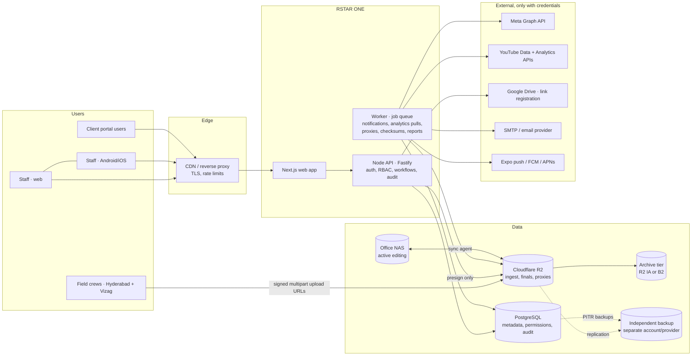

# RSTAR ONE — Architecture and implementation plan

Status: Milestone 1 (foundation). This document is the plan of record; each milestone updates it.

## 1. What we are building

One organisation operating system for RSTAR TV (primary brand, ~80% of the visual identity) and BusinessBOX / Stanley Enterprises (technology and operations partner, ~20%): HRMS, GPS attendance, leave, payroll, projects and tasks, the full media production lifecycle keyed by a permanent Content ID, central footage storage, social publishing and analytics, CRM, sales, finance, assets, notifications, reports, an employee self-service app and a client portal. Two branches (Visakhapatnam, Hyderabad), 10–20 staff now, designed for 100+.

## 2. System context



Key rule: **video bytes never pass through the API or the database.** Clients upload directly to object storage with short-lived signed multipart URLs; the API only creates upload sessions, verifies checksums and records metadata.

## 3. Technology decisions

| Layer | Choice | Why (ADR) |
|---|---|---|
| Monorepo | pnpm workspaces: `apps/api`, `apps/web`, `apps/mobile`, `packages/shared` | Shared types, validation and workflow rules across web, mobile and API ([ADR-0001](adr/0001-monorepo.md)) |
| Database | PostgreSQL 16 | Relational business data (payroll, finance, approvals), transactions for Content IDs, constraints and reporting ([ADR-0002](adr/0002-postgres-not-firestore.md)) |
| API | Node 22 + Fastify 5 + Zod | Fast, typed, schema-validated; same Zod schemas as clients |
| Auth | First-party: scrypt passwords, short-lived JWT access tokens, rotating opaque refresh tokens, TOTP MFA | No vendor lock-in; MFA and session revocation fully server-controlled ([ADR-0003](adr/0003-auth.md)). Can be swapped for Firebase Auth/OIDC behind the same session API. |
| Web | Next.js 15 (App Router) + TypeScript + Tailwind | Responsive, accessible, light-first UI |
| Mobile | Expo (React Native) | One codebase for Android and iOS; GPS, camera, background uploads, push |
| Media storage | Cloudflare R2 (S3-compatible) + office NAS + independent backup | Zero egress fees for previews/downloads; S3 API compatibility ([ADR-0004](adr/0004-media-storage.md)) |
| Jobs | Postgres-backed queue (pg-boss) in a separate worker process | No extra infrastructure at this size; moves to Redis/SQS if needed |
| CI/CD | GitHub Actions: typecheck, tests (with Postgres service), build | Once a repository is connected |
| Hosting | Web: Vercel or container; API/worker: container (Railway/Render/Fly/AWS); Postgres: managed (Neon/Supabase/RDS) with PITR | See [deployment.md](deployment.md) |

## 4. Code structure

```
apps/
  api/          Fastify API. src/modules/<domain>/{routes,service}.ts, SQL migrations in migrations/
  web/          Next.js web app (staff + client portal routes)
  mobile/       Expo app (employee + field workflows)
packages/
  shared/       Permissions, workflow state machines, Content ID formatting, Zod schemas, brand tokens, cost model
brand/          Supplied RSTAR TV logo (used as-is, never redrawn)
docs/           This documentation
```

Domains are separate modules with their own routes, services and tests; there is no shared "god" component. Each module owns its tables; cross-module links go through IDs (for example, every production record carries `content_id`).

## 5. Cross-cutting rules (enforced in code)

* **Server-side authorisation on every request.** The principal (roles, grants, branch, department) is reloaded from the database on each request, so role changes and deactivations take effect immediately. UI hiding is cosmetic only.
* **Scopes.** Each grant is `own`, `team`, `department`, `branch` or `org`. List endpoints add SQL predicates for the scope; single-record endpoints return 404 for out-of-scope records so they are not disclosed.
* **Audit.** Every sensitive mutation writes an `audit_events` row in the same transaction. The table is append-only (database trigger). Secrets and passwords are redacted before writing.
* **Optimistic concurrency** on workflow records (`version` column, `expectedVersion` in requests → 409 on conflict).
* **No hard deletes** for records that carry identity or money (content items, payroll runs, invoices); they are cancelled, reversed or archived.
* **Test mode is explicit.** Integrations without credentials run in a clearly labelled test mode (for example the mailer logs `[MAIL TEST MODE]` and the API reports `mailMode: "log"`). Nothing reports itself as "connected" without a verified credential.
* **Configuration over code.** Product name, branches, departments, roles, prefixes, leave and payroll rules live in the database and are editable by authorised admins.

## 6. Implementation plan (milestones)

| # | Milestone | Exit criteria |
|---|---|---|
| 1 | **Foundation** — architecture, data model, permission matrix, API contracts, workflows, storage/cost model, monorepo, auth + MFA, RBAC, org structure, employees, Content IDs, production workflow core, audit, web shell | Login, access tests, branch isolation, Content ID concurrency, workflow tests pass |
| 2 | HR: attendance with GPS geofences + anomaly flags, corrections, leave types/balances/approvals, holidays, employee documents | GPS and approval workflows pass tests and UAT |
| 3 | Payroll: salary structures, configurable statutory components, runs (draft → review → approve → lock), payslip PDFs, bank export | Calculation tests; accountant validates sample cases |
| 4 | Projects and tasks: Kanban/list/calendar, dependencies, recurring tasks, notifications (in-app, email, push) | Assignment and overdue alert tests |
| 5 | Media production: scripts with versions, shoots and crew/equipment, editing assignments and versions, reviews, content calendar | End-to-end Content ID lifecycle tests |
| 6 | Storage: upload sessions (S3 multipart, resumable), checksums, duplicates, proxies/thumbnails, library, quotas, retention, Drive-link registration, backup/restore test | Resumable upload + restore tests |
| 7 | Social publishing and analytics (manual + CSV + API adapters), CRM, sales pipeline | Snapshot integrity tests |
| 8 | Finance: invoices, bills, payments, expenses, purchase approvals, GST fields, P&L, cash flow, exports | Reconciliation tests |
| 9 | Mobile apps feature-complete, reports and dashboards, assets | Mobile tests on Android + iOS |
| 10 | Hardening: security review, load test, backups/DR drill, user manuals, launch checklist | All acceptance criteria |

## 7. Deployment environments

| Environment | Purpose | Data | Notes |
|---|---|---|---|
| `local` | Development | Seed + optional demo data (`is_demo = true`, labelled in UI) | `MFA_ENFORCEMENT=off` allowed, mail in test mode |
| `test` (CI) | Automated tests | Wiped per run | Real Postgres service container |
| `staging` | UAT with real users | Copy of production structure, no real salaries | Separate R2 bucket and credentials |
| `production` | Live | Real | MFA enforced, SMTP required, demo data refused, PITR backups, restore drill quarterly |

See [deployment.md](deployment.md) for setup and [security.md](security.md) for the threat model.
