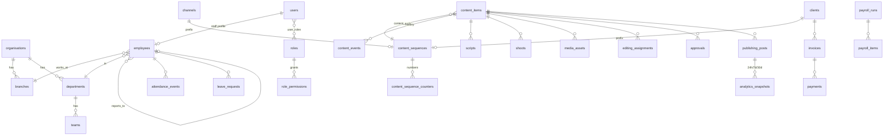

# Data model

PostgreSQL 16. ✅ = migrated and tested now (`apps/api/migrations/`). 🗓 = designed, migration lands in the named milestone.

## Conventions

* `uuid` primary keys (`gen_random_uuid()`); `bigserial` for append-only logs.
* Every business row has `organisation_id` (multi-tenant ready), `created_at`, `updated_at` (trigger), `created_by`, `updated_by`; `branch_id` where the record belongs to a branch.
* Money: `numeric(14,2)` in INR, never floats. Rates/percentages: `numeric(7,4)`.
* Status columns use `CHECK` constraints; transitions are enforced in services from `@rstar/shared`.
* Soft delete via `archived_at` / status where the record must be kept; identity- or money-bearing rows (content items, payroll runs, invoices, audit) can never be deleted (triggers).
* Sensitive fields (bank, PAN, UAN, MFA secrets) are AES-256-GCM encrypted at the application layer in addition to disk encryption.

## Entity overview



## Foundation ✅ (migration 0001)

| Table | Purpose | Key constraints / indexes |
|---|---|---|
| `organisations` | Legal name, configurable `product_name`, partner label, timezone, currency, settings JSON | — |
| `branches` | Visakhapatnam (VZG), Hyderabad (HYD), more later; `active` flag | `UNIQUE (organisation_id, code)` |
| `departments` | 8 seeded departments, configurable | `UNIQUE (organisation_id, code)` |
| `teams`, `designations` | Sub-structure and job titles | unique names per org |
| `users` | Login identity: `kind` staff/client, email (citext), scrypt hash, encrypted MFA secret, status, lockout counters, `client_id` for portal users | `UNIQUE (organisation_id, email)`; client users must have `client_id` |
| `sessions` | One per device; hashed rotating refresh token, expiry, revocation | partial index on active sessions per user |
| `one_time_tokens` | Invitation and password-reset tokens (hashed, single use) | `UNIQUE (token_hash)` |
| `roles`, `role_permissions` | Seeded + custom roles; grant = permission key + scope | `PRIMARY KEY (role_id, permission_key)` |
| `user_roles` | Role assignment with grantor and time | `PRIMARY KEY (user_id, role_id)` |
| `employees` | HR profile 1:1 with a staff user: code, contact, address/emergency (JSON), branch, department, team, designation, reporting manager, employment type, status (onboarding → probation → active → notice → exited → archived), joining/probation/exit dates, skills | `UNIQUE (organisation_id, employee_code)`; indexes on branch, department, manager; self-reporting forbidden |
| `employee_sensitive` | Encrypted bank / IFSC / PAN / UAN blob | 1:1 with employee; every read audited |
| `employee_history` | Created, transfer, status, designation, manager, roles changes with before/after | index `(employee_id, created_at)` |
| `audit_events` | Append-only audit log: actor, action, entity, before/after (redacted), IP, user agent, request id | UPDATE/DELETE blocked by trigger; indexes by entity, actor, time |

## Production core ✅ (migration 0002)

| Table | Purpose | Key constraints / indexes |
|---|---|---|
| `clients` | Client master (CarCart, Avakai, Avakai.com, Pulse Hospital, …); full CRM fields in M7 | `UNIQUE (organisation_id, name)` |
| `channels` | RSTAR News, Health, Bhakthi, Entertainment, Opinions | `UNIQUE (organisation_id, name)` |
| `content_sequences` | One per client or channel: `prefix`, `segment_mode` (none/year/campaign), `padding` | `UNIQUE (organisation_id, prefix)`; exactly one of client/channel |
| `content_prefix_history` | Retired prefixes — can never be issued again | `PRIMARY KEY (organisation_id, prefix)` |
| `content_sequence_counters` | Last issued number per sequence and segment; the concurrency control point | `PRIMARY KEY (sequence_id, segment)` |
| `content_items` | The content record: `content_code`, title, brief, client/channel, branch, department, format, platforms, language, priority, `stage`, `stage_owner_id`, `stage_entered_at`, `stage_due_at`, role assignees (producer, script writer, camera, editor, publisher), `revision_count`, `version`, `cancel_reason`, `is_demo` | `UNIQUE (organisation_id, content_code)`, `UNIQUE (sequence_id, sequence_segment, sequence_value)`; DELETE blocked; indexes by stage+due, owner, client, channel, branch, editor |
| `content_events` | Append-only lifecycle history: created / transition / assignment / escalation / comment with note and actor | index `(content_id, id)` |
| `content_comments` | Comments with `internal` / `client` visibility | index by content + time |
| `notifications` | In-app notifications | partial index on unread |

### How Content IDs stay unique and sequential

```sql
-- inside the same transaction as the content_items INSERT
INSERT INTO content_sequence_counters (sequence_id, segment, last_value) VALUES ($1, $2, 1)
ON CONFLICT (sequence_id, segment) DO UPDATE SET last_value = content_sequence_counters.last_value + 1
RETURNING last_value;
```

The counter row is locked until commit, so concurrent creators queue on it and each gets the next number. If the transaction fails, the increment rolls back with it (the number was never issued). Once an item exists it can never be deleted, so its number is never reused. Prefix changes retire the old prefix permanently. Tested with 60 simultaneous requests (`apps/api/test/content-id.test.ts`).

Formats: `CC001`, `RN012`, `PH042`, `CC1234` (numbers grow past the padding), `RS-2026-001` (year segment), `FC-DIWALI-002` (campaign segment).

## Planned tables 🗓

### Attendance (M2)
* `geofences` — branch, centre lat/lng, radius m, max accuracy m, active.
* `shifts`, `attendance_policies` — start/end, grace minutes, late/early thresholds, half-day rules, break tracking, WFH/field rules (all configurable).
* `attendance_events` — employee, type (check_in/check_out/break_start/break_end), server time, client time, lat/lng, accuracy, geofence result, distance, mode (office/wfh/field), device info, mock-location flag, anomaly flags, idempotency key. Index `(employee_id, server_time)`.
* `attendance_days` — derived daily ledger: status (present/late/half_day/absent/on_leave/holiday/wfh/field), first in, last out, worked minutes, source; `UNIQUE (employee_id, date)`.
* `attendance_corrections` — request, reason, evidence, approver, decision; manual entries always go through here.
* `holidays` — branch-scoped calendar.

### Leave (M2)
* `leave_types` — code, name, paid, requires document after N days, accrual rule (monthly/yearly), carry-forward cap, encashable, applicable branches.
* `leave_balances` — employee, type, year, opening, accrued, used, adjusted; `UNIQUE (employee_id, leave_type_id, year)`.
* `leave_requests` — dates, half-day flags, days, reason, document asset, status (pending/approved/rejected/cancelled/withdrawn), approver chain position.
* `leave_approvals` — step, approver, decision, note.

### Payroll (M3)
* `salary_components` — code, earning/deduction, calculation (fixed, % of basic, % of gross, formula), taxable, statutory flag, active. **No hardcoded statutory rates**: PF/ESI/PT/TDS parameters live in `statutory_settings` with effective dates and must be reviewed by a qualified accountant.
* `salary_structures`, `salary_structure_lines`, `employee_salaries` (effective-dated).
* `payroll_runs` — period, status draft → validated → hr_reviewed → approved → paid → locked; approved runs immutable.
* `payroll_items` — per employee per component, with inputs (paid days, LOP days, overtime hours) and calculated amount.
* `payroll_adjustments`, `advances`, `advance_recoveries`, `reimbursements`.
* `payslips` — run, employee, PDF asset, issued_at.

### Projects and tasks (M4)
* `projects` (client or internal, manager, dates, status), `project_members`.
* `tasks` — project, parent task, title, description, priority, status (backlog/todo/in_progress/review/blocked/completed), due, estimate, recurrence rule, `content_id` optional.
* `task_assignees`, `task_dependencies` (no cycles, checked in service), `task_comments`, `task_events`, `task_attachments`.

### Media production detail (M5)
* `scripts`, `script_versions` (scene-by-scene JSON, dialogue/VO, shot list, props, locations), `script_reviews`.
* `content_calendar_entries`, `campaigns`, `special_days` (festivals).
* `shoots` (location, schedule, client contact, status, checklist), `shoot_crew`, `shoot_equipment`, `shoot_expenses`.
* `editing_assignments` (editor, assigned/started/paused/resumed/submitted times, first-cut and final deadlines), `edit_time_logs` (separate for hybrid camera/editors), `versions` (cut number, kind, asset).
* `approvals` (content, round, reviewer, kind internal/client/management, decision, notes).

### Media storage (M6)
* `storage_locations` (R2 bucket, archive, backup, NAS) with credentials referenced by secret name only.
* `upload_sessions` — content, folder, filename, size, mime, part size, S3 upload id, parts received, sha256 expected/actual, status, expires_at, uploader, branch.
* `media_assets` — content, folder (`01_RAW_FOOTAGE`…`05_FINAL_EXPORT`), object key, size, mime, sha256 (`UNIQUE (organisation_id, sha256)` for duplicate detection), duration, resolution, codec, proxy/thumbnail keys, storage tier, retention class, legal hold, lifecycle state, version.
* `external_links` — registered Google Drive links (owner, folder, verified flag) for gradual migration.
* `download_events`, `archive_jobs`, `restore_jobs`, `backup_checks`.

### Social publishing and analytics (M7)
* `platform_accounts` — platform, external id, token secret reference, scopes, token expiry, status (`connected` only after a verified API call).
* `publishing_posts` — content, platform, caption, hashtags, cover asset, scheduled/actual time, URL, external post id, organic/paid, publisher.
* `analytics_snapshots` — post, window (`24h`/`7d`/`30d`), source (`manual`/`csv`/`api`), collected_at, metrics JSON plus typed common columns, raw payload; `UNIQUE (post_id, window)` so snapshots are never double-counted.

### CRM, sales, finance, assets (M7–M9)
* `contacts`, `contracts`, `service_packages`, `retainers`, `deliverables`, `meetings`, `client_feedback`, `client_users` (portal access flags).
* `leads`, `lead_stages`, `lead_activities`, `proposals`, `quotations`, `sales_targets`, `commission_rules`.
* `accounts` (cash/bank), `expense_categories`, `vendors`, `invoices`, `invoice_items` (GST fields: HSN/SAC, rate, CGST/SGST/IGST amounts — configurable, not a GST filing system), `payments`, `bills`, `expenses`, `purchase_requests` (approval thresholds), `budgets`, `recurring_expenses`, `journal_entries`.
* `assets` (asset code, category, serial, branch, assignee, purchase, warranty), `asset_events` (assign/return/transfer/maintenance/damage), `supplies`.
* `notification_preferences`, `push_tokens`, `report_schedules`.

## Retention (defaults; configurable, legal review required)

| Data | Default retention |
|---|---|
| Audit events | 8 years (aligned with Indian accounting record-keeping); never edited |
| Payroll, invoices, payments | 8 years after financial year end |
| Attendance raw GPS points | 12 months, then reduced to the daily ledger (no coordinates) |
| Exited employee profiles | Kept for statutory period, then archived with personal fields minimised on request |
| Raw footage | Hot 90 days after final approval → archive; deletion only via approved retention policy, never automatic by default |
| Sessions, one-time tokens | Purged 30 days after expiry |
