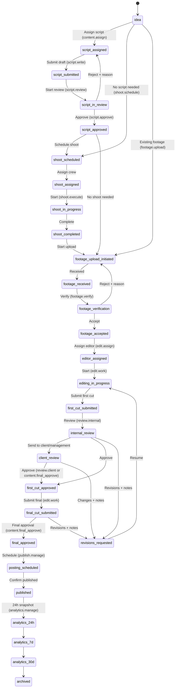

# Workflows and state transitions

The production workflow below is implemented and tested (`packages/shared/src/content-workflow.ts`, `apps/api/src/modules/content/service.ts`). The others are the agreed designs for their milestones.

## 1. Media production lifecycle ✅

Every content item has one stage, one stage owner, a stage due date, timestamps, comments and an append-only history. Every transition is checked against the actor's permission **and** scope, writes a history row and an audit event in the same transaction, and notifies the new owner.



* The spec's 27 stages are all present. One explicit stage, **First cut approved**, was added so a review approval is a recorded state rather than an implicit jump; **Cancelled** is reachable (with a reason) from any stage before publishing.
* **Rejections and revision requests require a reason**; revision requests increment `revision_count` (editor metrics).
* **Assignment:** transitions that hand work to a role (script writer, camera, editor, publisher, producer) take `assigneeUserId`; the API checks the assignee actually holds the permission for that work. Reassignment and escalation endpoints arrive with M5.
* **Who may act:** `own`-scoped roles (writers, camera, editors) can act only on items assigned to them; producers/managers act on their branch, department or the whole organisation per their scope; client portal users can only approve or request changes at **Client review** on their own client's content and see client-safe fields only.
* **Concurrency:** two people acting at once → one succeeds, the other gets 409 and reloads.
* **Content ID** is allocated at creation and never changes, including after cancellation.

## 2. Attendance 🗓 (M2)

```
check-in request (employee-initiated only)
  → server time recorded; client time stored for comparison
  → accuracy > threshold?            → pending_exception (employee adds reason)
  → outside branch geofence?         → mode office: outside_geofence → pending_exception
                                        mode field/wfh: allowed if policy permits, flagged for manager
  → mock-location / impossible travel / device change / clock skew → flags[], still recorded, queued for review
  → otherwise verified
daily ledger recomputed: present / late (after grace) / half-day / absent / on_leave / holiday / wfh / field
corrections: requested → approved | rejected (attendance.approve; never self-approved); manual entries are corrections with an audit trail
```
GPS is never collected outside a check-in/check-out the employee starts. See the location policy in [security.md](security.md).

## 3. Leave 🗓 (M2)

`draft → pending → approved | rejected`, `pending → withdrawn` (employee), `approved → cancelled` (employee before start, or approver). Approval chain: reporting manager → department head (configurable per leave type and duration). Balances are reserved at `pending` and committed at `approved`. Only **approved** leave updates the attendance ledger and payroll (unpaid leave → loss of pay days).

## 4. Payroll 🗓 (M3)

`draft → validated → hr_reviewed → approved → paid → locked`
* `draft`: generated from active salary structures + approved attendance/leave + approved adjustments, advances, reimbursements, incentives.
* `validated`: system checks (missing bank details, negative net pay, unusual change vs last month).
* `hr_reviewed`: by `payroll.process` holder. `approved`: by a **different** person with `payroll.approve`.
* Approved runs are immutable; corrections are adjustment/reversal lines in the next run.
* Statutory components (PF, ESI, PT, TDS) are configuration with effective dates and require accountant sign-off before live use.

## 5. Tasks 🗓 (M4)

`backlog → todo → in_progress → review → completed`, any open state ↔ `blocked` (with reason). A task with incomplete dependencies cannot move to `in_progress`. Recurring tasks spawn the next instance on completion or on schedule.

## 6. Finance approvals 🗓 (M8)

Purchase requests and expenses: `submitted → approved | rejected → paid`. Approval thresholds are configured per amount band (e.g. up to ₹X by department head, above by Management). The person who records a payment cannot approve the same request (separation of duties).

## 7. Uploads 🗓 (M6)

`created → uploading (parts) → completing → verifying → available | failed`; `uploading → expired` after the session TTL (parts are cleaned up); resume = `GET /uploads/:id` to see confirmed parts, then upload only the missing parts.
